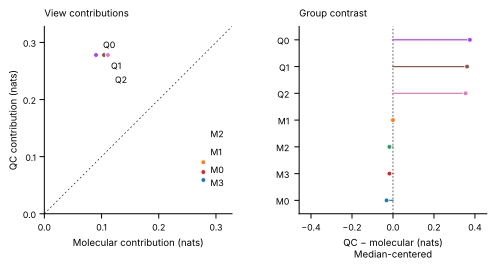

# Work with your agent

Bring a biological question and your data. Your agent can inspect the inputs,
choose an ITCA+ workflow, explain its decisions, and return a table and plot.
The worked audit below shows what that looks like.

## Install from a GitHub link

Install the [Python package](installation.md) in your analysis environment.
Paste this in Codex to install the skill from the public GAUGE repository:

> Install the GAUGE skill from <https://github.com/zhanglabtools/gauge-sc/tree/main/.agents/skills/gauge>.

The link goes straight to the skill directory, so you do not need to name an
installer or supply an internal path. Codex also [discovers the checked-in skill](https://learn.chatgpt.com/docs/build-skills)
when you work in a software checkout. Installing the skill adds guidance; the
Python package supplies the computation.

## Watch an audit take shape

Codex used the GAUGE skill to generate and run [this notebook](../notebooks/07_agent_audit.ipynb).
It uses the 560-cell teaching example so the whole workflow runs without a download.

**The task**

> Use $gauge to audit the grouping `group` in the teaching example.
> Inspect its inputs, choose appropriate views and settings, and explain your
> choices. Show a table and a figure that help me understand the group contrasts.

### The agent checks and chooses

The data contain seven groups of 80 cells, a supplied 15-component molecular
representation and three numeric QC covariates. The provenance identifies
expression as synthetic features and QC as independently simulated covariates.
The agent uses those supplied views and excludes the known design annotation.

| Decision for this run | Why |
|---|---|
| Molecular PCA versus QC; log1p the two count-like covariates | Compare the support carried by two distinct views; handle the counts' wider scale. |
| Five paired folds with pooled recall | Each group has 16 held-out cells per fold; every cell contributes one held-out prediction. |
| Require at least 10 test cells; leave screening off | Support is sufficient, and the question asks for continuous contrasts. |

These choices belong to this run. The skill does not prescribe their values.
If the input or scientific goal were unclear, the agent would ask before choosing
the grouping or reference view.

### The agent returns evidence



Contributions and centered contrasts are in nats:

```{csv-table}
:file: assets/agent-audit-table.csv
:header-rows: 1
```

```{include} assets/agent-audit-summary.md
```

The agent reports this as a group-level description; it has not made screening
calls or removed cells.

### Keep working from the same evidence

The notebook saves and reloads the evaluation, then verifies that the resumed
audit is identical and the inputs are unchanged. A follow-up can change audit
settings without fitting the classifier again:

> Use the saved evaluation to assess whether candidate screening would help this
> question. Recommend a suitable sensitivity range and explain which conclusions
> remain stable.

Changing the labels or input features instead requires another evaluation.
The [notebook](../notebooks/07_agent_audit.ipynb) contains the executable workflow;
the [run record](assets/agent-audit-run.json) retains settings, versions and source hashes.

## Take it to your data

Each application tutorial ends with a task prompt. Try the
[real human–mouse mixture](../notebooks/real_data/11_mixture_audit.ipynb),
[spatial hierarchy](../notebooks/real_data/12_spatial_hierarchy.ipynb), or
[workflow comparison](../notebooks/real_data/13_workflow_endpoints.ipynb).
Replace the dataset and question, then let the agent recommend suitable views
and settings or ask about the scientific intent.

Agents can use Python or the [CLI](cli.md). The three computations are the same:
`evaluate` measures ITCA support, `audit` compares view contributions, and
`select` chooses retained structure with ITCA+. Plotting and saved-result
loading remain available through `gauge.pl` and `gauge.io`.
