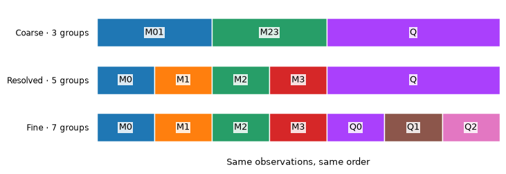
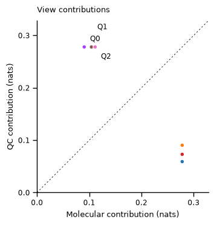

# What does a grouping tell us?

**Which distinctions are supported by the data—and which are worth retaining?**
ITCA evaluates a fixed grouping from a specified view. The grouping can come from
clustering, an annotation or transferred labels; it is not generated by ITCA.

## Same cells, different questions

Rows contain the same synthetic cells in the same order, not an embedding.
M0–M3 have distinct expression programs; Q0–Q2 share one. More labels do not
necessarily mean more molecularly supported distinctions.

## Accurate prediction is not the whole story

Both the coarse and resolved groupings can be predicted accurately. The resolved
grouping nevertheless carries more distinguishable label information, giving it
higher molecular ITCA.

| Grouping | Groups | Held-out accuracy | Molecular ITCA |
|---|---:|---:|---:|
| Coarse | 3 | 1.000 | 1.079 |
| Resolved | 5 | 1.000 | 1.475 |
| Fine | 7 | 0.729 | 1.418 |

**ITCA adds up each group's information-weighted prediction support.**

The one formula

Group contribution = **p × log(1/p) × held-out recall**.

`p` is the population fraction. The information term weights what the label tells
us; recall measures how well it is predicted from the specified view. Contributions
sum to ITCA. Rare labels carry more information per observation, but population
weighting means rarer groups do not always contribute more.

## Extra detail has a cost

**ITCA+ subtracts a complexity penalty.** In this example, a mild penalty retains
five groups; a stronger penalty retains three. The population ratio calibrates
this cost—it does not remove small groups. The runnable guide displays raw ITCA,
penalty and ITCA+ separately.

| Population ratio | Selected grouping | ITCA | Penalty | ITCA+ |
|---|---|---:|---:|---:|
| 0.01 | Resolved · 5 groups | 1.475 | 0.230 | 1.245 |
| 0.10 | Coarse · 3 groups | 1.079 | 0.691 | 0.388 |

Each row is a separate choice of penalty, not a comparison of scores across settings.
These are illustrative choices, not universal defaults.

## Supported by which view?

Each point is a group. Above the diagonal, QC contributes more than expression.
The same Q labels receive different support from these two views. **Support is
view-specific, not proof of biological truth or technical artifact.** QC covariates
are independently simulated, not derived from the expression matrix.

[Run this example](../notebooks/00_concepts.ipynb) · [Choose an application](../notebooks/README.md)

These are controlled teaching data. Labels and representations are fixed before
prediction; this does not independently validate their generating workflow.
